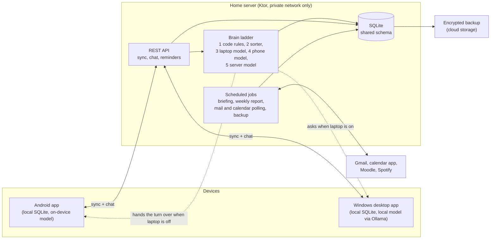

# Wally

A private personal assistant for one person: Android and Windows apps that log your day, sync through your own home server, and answer chat questions using code first and local AI models second, so nothing depends on a paid AI subscription.

> Built with AI coding assistance. I designed the system and directed the build; AI coding agents (Claude Code and Codex) wrote most of the code. See [My role](#my-role).

## Why I built it

I wanted an AI like Jarvis, but I also wanted my data to stay safe, and I didn't want to use up all the tokens on my AI subscriptions. So Wally runs on my own devices: plain code answers what it can, and small local models handle the rest.

## What it does

These features are built and have tests in this repo (Phases 1–20):

- **Daily logging** on phone and laptop: daily check-in, spending, journal notes, tasks, meals with AI-estimated nutrition, and a dream journal.
- **Offline-first sync**: each app keeps a full local SQLite copy and syncs with the server when it can (last edit wins, soft deletes).
- **Charts and insights**: spending, health and screentime charts, and goals.
- **Connected data**: unread Gmail, calendar events (from a separate calendar app of mine), Garmin health data through Android Health Connect, Moodle study files, phone and laptop screentime, Spotify.
- **Chat over your own data**: ask questions ("how much did I spend on food last month") and make changes by chat. A new entry is saved with an Undo button; a change to an existing entry needs a Yes/No card. Chat never deletes.
- **The "brain ladder"**: every chat message climbs a ladder and stops at the first step that can handle it:
  1. guard checks and instant code rules for clear commands,
  2. a small read-only sorter that matches reworded questions by meaning (an embedding model),
  3. the laptop's local model when the laptop is on,
  4. a model running inside the phone, with no internet, when the laptop is off,
  5. a small model on the server as a last resort.
- **Morning briefing and Sunday weekly report**, written on the server by a local model.
- **Phone reminders**: check-in, morning list, heads-ups.
- **Encrypted nightly backups** of the server database.

## Status

- **Works now:** Phases 1–20 are finished. The apps are at version 1.18.0. Each phase closed only after its acceptance tests passed and I approved it.
- **Known gaps I accepted:** a few kinds of chat message (moving an item, "everything" questions) are still handled differently from what was meant. The "Ask model" button is the way round.
- **In progress:** nothing is being built right now. Phases 21 and 22 exist as draft plans (in `docs/plan/wally-input-handler/`) and have not passed review yet.
- **Planned:** Phases 21–33, see [Roadmap](#roadmap).
- **About this public copy:** it is a cleaned copy of my private development repo. Addresses, account names and server access notes were replaced or left out, and only one phase record (Phase 19) is included as an example of the workflow. Wally was built for my own devices, so running it yourself means supplying your own server, accounts and models.

## How it works



- **`shared`** is a Kotlin Multiplatform library that holds almost everything the apps do: the database schema, the sync engine, chart data, the chat client with its offline send queue, and all the screens (Compose Multiplatform).
- **`androidApp`** and **`desktopApp`** are thin entry points around `shared`. Each works offline and syncs on open, after each save, and on a timer.
- **`server`** is a Ktor server that listens only on a private network (Tailscale) and requires a token per device. It is the only place a chat result is saved, whichever model answered.
- **Code never guesses.** If a message is not a clear match for a code rule, it moves to the next step of the ladder. Nothing is saved from chat without a clear match or a tap.
- **Privacy rule:** dream entries never enter an AI prompt except for dream analysis.

## Tech stack

- **Language and build:** Kotlin 2.4, Gradle 9 (wrapper included)
- **Apps:** Compose Multiplatform for Android (minSdk 26) and Windows desktop (JVM, MSI installer); WorkManager for background sync; Android Health Connect
- **Server:** Ktor 3 (Netty) on Debian, run by systemd
- **Database:** SQLite through SQLDelight, one shared schema for server and apps, with migration files
- **Local AI:** Ollama on the server and the laptop; LiteRT-LM running a Gemma model on the phone; an embedding model for the sorter
- **Libraries:** kotlinx.serialization, kotlinx-datetime, kotlinx-coroutines, Ktor client, Apache PDFBox and POI (study files), JNA (Windows screentime)
- **Networking and ops:** Tailscale, rclone (encrypted backups), systemd timers
- **Tests:** `kotlin("test")`, Ktor `testApplication` and `MockEngine`, plus a separate acceptance-test module
- **Build workflow:** Claude Code, Codex CLI, a small Node.js Telegram connector (MCP server)

Exact versions are in `gradle/libs.versions.toml` and `Overview.md`.

## My role

I did not write this code by hand. What I did:

- **Designed the product:** what Wally logs, what the chat may and may not do, how the screens are laid out (the design canvases are in `docs/plan/wally-redesign-v2/canvas/`). The specs in `docs/plan/` were written with an AI planning assistant: it asked the questions and wrote the text, I made the choices.
- **Made the decisions:** every plan has a `DECISIONS.md` with the options considered and the one I chose. Some examples:
  - chat runs on the home server, so the phone can chat when the laptop is off;
  - code first, a model only when code can't answer, and code never guesses;
  - chat can add and change but never delete, and a change to an existing entry always needs a Yes/No card;
  - when the server's 2-core processor turned out too slow for a capable model, the answer became the ladder (laptop model, then a model inside the phone) instead of a cloud AI.
- **Built the workflow** the agents work in (next section): the roles, the rules, the safety hooks and the approval steps.
- **Reviewed and approved:** I approved every merged phase plan before any code was written, did the manual checks on the real phone and laptop, and decided which known gaps to accept.

**What the AI agents did:** wrote the detailed plans from my specs, wrote the Kotlin code, wrote and ran the tests, and diagnosed failures. Claude Code did the coding; Codex only planned and reviewed.

## How it was built

I built a two-manager, multi-agent workflow and used it for every phase. All of it is in this repo: the rules in `CLAUDE.md` and `AGENTS.md`, the agent definitions in `.claude/agents/`, `.codex/` and `.agents/`, the hooks in `.claude/hooks/`, and the launcher and Telegram connector in `scripts/`. `SETUP.md` explains how to set it up.

One phase goes like this:

1. **Spec first.** The phase's requirements and acceptance criteria go into `phases.md`, taken from the longer plans in `docs/plan/`.
2. **Two blind plans.** A Claude manager and a Codex manager each plan the phase without seeing the other's plan. Codex never writes code: its researcher proposes up to five ideas, and its reviewer checks each idea against the existing code.
3. **Clarify over Telegram.** Claude asks Codex questions about its plan in a Telegram group (at most five). Codex may answer only from its own plan files. I watch but don't take part.
4. **Merge.** Claude merges the two plans into one handoff file with a Decisions table. Claude has the final say.
5. **I approve.** Nothing is coded before I say go.
6. **Rounds.** A coder agent builds the phase. A tester agent writes acceptance tests from the criteria, not from the code. If tests fail, a debugger agent writes the root cause and a fix plan, and the coder fixes it. There are at most three fix rounds before a re-plan.
7. **Definition of Done.** Every acceptance criterion needs evidence, the whole test suite must pass, and the diff may only touch the folders the plan named.

Guard rails: hooks stop each agent from writing outside the folders it owns and from running dangerous git commands, and only the manager may commit.

### Example: the clarify step in Phase 19

Phase 19 put a model inside the phone. After both plans were written, Claude asked Codex two questions in the Telegram group (bot names changed, text shortened):

> **Claude bot:** `/ask P19-C-CDX-01 | Ref: codex plan.md > Implementation decisions, foreground bullet` — Does "foreground-only Android chat draining" mean every Android background drain skips ALL queued chat messages, or only queued items that already received a phone turn that has not yet expired?
>
> **Codex bot:** `P19-C-CDX-01` — The proposed simplest bounded policy skips ALL Android chat outbox delivery while the app is in the background […] Claude can choose a narrower implementation if it still cannot claim an abandoned turn before expiry.
>
> **Claude bot:** `/ask P19-C-CDX-02 | Ref: codex plan.md > Compatibility C7` — For "an expiry scan must not wait behind a long already-claimed RUNNING request", do you propose tryLock on the chat's turn lock, a separate coroutine per chat, or something else?
>
> **Codex bot:** `P19-C-CDX-02` — Not in our plan. C7 and the expiry bullet require avoiding head-of-line wait […] but do not select tryLock, separate per-chat coroutines, or another concrete locking mechanism.
>
> **Claude bot:** `/close P19` — Phase 19: questions closed.

The second answer shows the rule at work: Codex says "Not in our plan" instead of making something up, and the decision stays with the Claude manager. The full record of this phase is in the repo: both plans in `managers/claude/plans/phase-19/` and `managers/codex/plans/phase-19/`, the saved questions and answers in `managers/claude/plans/phase-19/clarifications.md`, and the merged plan with every coder, tester and debugger report in `handoffs/phase-19.md`.

## Getting started

Wally was built for one set of devices, so treat this as a guide to reading and building the code, not a one-click install.

**Prerequisites**

- Windows with PowerShell (the scripts and commands are written for it)
- JDK 21 to run Gradle, and JDK 17 for the code (the build uses a Java 17 toolchain)
- Android SDK (for the phone app), with `ANDROID_HOME` set or a `local.properties` file
- For the full system: a Debian server, Tailscale, Ollama, and your own Google, Spotify and Moodle credentials

**Install**

Nothing to install by hand. The Gradle wrapper downloads everything on the first build.

**Configure**

- The server reads a JSON config file. Copy `ops/config.example.json` and fill in your own values.
- `.env.example` lists every environment variable the project reads (the Telegram connector's tokens and a few optional test switches). Wally does not load a `.env` file; set them in your shell or with `setx`.

**Run**

```powershell
.\gradlew build                 # build everything
.\gradlew :desktopApp:run       # start the desktop app with a dev database
```

**Run tests**

```powershell
.\gradlew :server:test :shared:jvmTest    # unit tests
.\gradlew check                           # everything, including tests/acceptance
```

What was checked on this public copy (Windows, 2026-11-17):

- `.\gradlew :shared:jvmTest`: passed.
- `.\gradlew :server:test`: 810 tests ran, 805 passed, 5 failed. The 5 compare prompt text files byte for byte and are sensitive to Windows/Unix line endings.
- `.\gradlew :acceptance:test`: 580 tests ran, 577 passed, 3 failed. They check project documents (server notes, a phase report) that are not part of this public copy.
- Not tested on this copy: `.\gradlew build`, `.\gradlew :desktopApp:run`, the Android build, and deploying the server.

## Project structure

```
shared/         Shared Kotlin code and all screens (schema, sync engine, chat client, UI)
androidApp/     Android entry point, manifest, on-device model
desktopApp/     Windows entry point and MSI packaging
server/         Ktor server: sync, chat and the brain ladder, scheduled jobs
tests/          Acceptance tests (Gradle module :acceptance)
docs/plan/      Specs, plans, decision logs and design canvases
ops/            Deploy script, systemd units, backup scripts, setup notes, manual checklists
handoffs/       The record of a phase (Phase 19 included as an example)
managers/       Each manager's plan for a phase (Phase 19 included as an example)
.claude/        Claude Code agents, skills and safety hooks
.agents/ .codex/  Codex roles, skills and settings
scripts/        Phase launcher and the Telegram connector
Overview.md     Short project overview the managers read every phase
phases.md       Requirements and acceptance criteria for Phases 1–20
CLAUDE.md AGENTS.md SETUP.md   Workflow rules and setup
```

The planning documents call the app's single user "Tim".

## Roadmap

These are plans, not finished work. Phases 21 and 22 are drafts in `docs/plan/wally-input-handler/`; the rest are listed in `Overview.md` and planned outside this repo. None has passed review yet.

| Phase(s) | Plan |
|---|---|
| 21 | More jobs handled by code: corrections of today's entries, calendar events, two commands in one message, and number answers (totals, averages, streaks) |
| 22 | Learning from taps (taught shortcuts) and a weekly "what I didn't understand" list |
| 23–25 | A browser extension for Brave |
| 26 | More tools: reminders from chat, repeating tasks, budgets, remembered facts, moving a calendar event |
| 27 | Learning from my fixes, and spotting patterns in my data |
| 28 | Goals that start with a short interview |
| 29 | Automatic spending entries from Google Pay notifications |
| 30–31 | Focus mode, first on the laptop, then on the phone |
| 32–33 | Wally Voice |

## License

No license. All rights reserved. The code is published so it can be viewed; it may not be copied, modified or reused without my permission.
